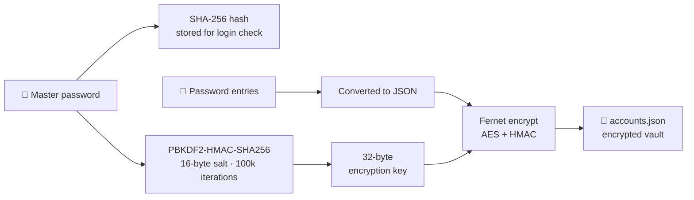

<div align="center">


**A command-line password manager that stores login credentials in an encrypted vault. The master password is never stored in plain text.**


[](https://github.com/dzenan27)

<br/>


<br/>

**Jump to:**
[Demo](#demo) • [Features](#features) • [Security](#security) • [Tech](#tech) • [Installation](#install) • [Usage](#usage) • [Files](#files) • [License](#license)

</div>

---

<a id="demo"></a>
## 🎬 Demo Walk-Through

https://github.com/user-attachments/assets/29619ebf-b472-47ab-903e-0f008d901a7f

---

<a id="features"></a>
## 🚀 Main Features

| Feature | What it does |
|---|---|
| 🔑 **Master account security** | Master passwords are hashed with SHA-256, each account gets a unique random salt, and the encryption key is derived with PBKDF2-HMAC-SHA256 at 100k iterations |
| 🔒 **Encrypted vault** | All stored credentials are encrypted with Fernet (AES-based). Vault data in `accounts.json` appears only as unreadable encrypted text, and it is decrypted only after a successful login |
| 📁 **Password management** | Add new website/app credentials, view saved passwords (after decryption), and delete entries securely |
| 💾 **Local storage** | `accounts.json` holds the encrypted user data. No plaintext passwords ever appear in storage |

---

<a id="security"></a>
## 🚨 How Security Works



<details open>
<summary><b>🔑 Master password hashing</b></summary>

<br/>

- SHA-256 is used to hash the master password
- The hash is stored, never the real password

</details>

<details open>
<summary><b>🧂 Key derivation</b></summary>

<br/>

- A random 16-byte salt is created per user
- PBKDF2-HMAC-SHA256 derives a 32-byte encryption key
- 100,000 iterations slow down brute-force attacks

</details>

<details open>
<summary><b>🔒 Vault encryption</b></summary>

<br/>

- Your password entries are converted to JSON
- The JSON is encrypted using Fernet (AES + HMAC)
- The encrypted result is saved to `accounts.json`
- Only your correct master password can generate the proper decryption key

</details>

### 🔒 File encryption and hashing


---

<a id="tech"></a>
## 🧪 Technologies Used

| Technology | Purpose |
|---|---|
| **Python 3.14.0** | Core language |
| `hashlib` | SHA-256 hashing |
| `cryptography` | Fernet + PBKDF2HMAC |
| `getpass` | Hidden password input |
| `json` | Local storage |
| `os` / `base64` | Salt generation + encoding |

---

<a id="install"></a>
## ⚙️ Installation

1. Make sure Python 3.x is installed correctly
2. Install the required package:

```bash
pip install cryptography
```

3. Run the script:

```bash
python3 password_manager.py
```

---

<a id="usage"></a>
## ✅ How to Use

Start the program with `python3 password_manager.py`.

<table>
<tr>
<th>🏠 Main menu</th>
<th>🔓 Vault menu (after login)</th>
</tr>
<tr>
<td>

```
1) Create account
2) Login
0) Exit
```

</td>
<td>

```
1) Add new password
2) View saved passwords
3) Delete password
0) Logout
```

</td>
</tr>
</table>

After creating an account and logging in, you gain access to your encrypted vault.

### 📸 Terminal preview


---

<a id="files"></a>
## 📂 File Structure

```
├── password_manager.py   # Main application
└── accounts.json         # Encrypted data storage
```

---

<a id="license"></a>
## 📄 Licensing

This project may be freely modified and used for learning or personal use. You may access the code from this repository.

---

<div align="center">

*This password manager is a portfolio and educational project demonstrating hashing, key derivation, and symmetric encryption in Python.*

[](https://github.com/dzenan27)
[](https://www.linkedin.com/in/dzenanm)


</div>
